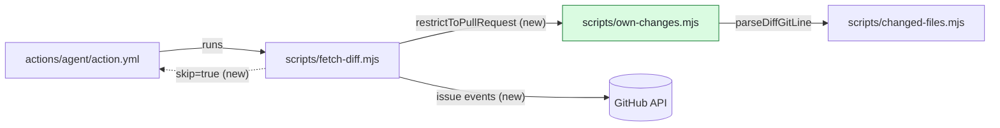
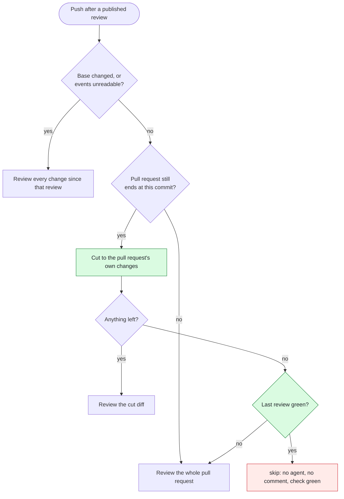

### Review guide — 6 groups, 2 to read closely

**In short.** After a green review, a merge of `main` into a pull request made the next incremental
review cover code from other pull requests. This pull request cuts the incremental diff down to the
pull request's own changes. When a merge brings nothing of its own and the last review was green, no
agent runs. A change of the base branch turns off both rules.

**Intent.** The changes match the description. No change is outside the described scope. No linked
issue.

#### Where to look first

| # | Group | Reading mode | If this is wrong | Changes |
| --- | --- | --- | --- | --- |
| 1 | [Skip decision in `fetch-diff.mjs`](https://github.com/deyai-labs/pr-pitcrew/pull/43/files#diff-38f1acff8b03b0208de7e60012b63652c5bf074a9cedbfabdf0eb098872a4e97R386) | ▰▰▰ Read closely | Unreviewed code gets a green check. | +67 −4 |
| 2 | [Base-change guard](https://github.com/deyai-labs/pr-pitcrew/pull/43/files#diff-38f1acff8b03b0208de7e60012b63652c5bf074a9cedbfabdf0eb098872a4e97R221) | ▰▰▰ Read closely | A base switch plus a merge gets past the review. | +51 −2 |
| 3 | [Diff cut in `own-changes.mjs`](https://github.com/deyai-labs/pr-pitcrew/pull/43/files#diff-2d976e6398eee16aabe46ddb2be3b6a8f400d6ae734cc5f74d8e767a077759caR253) | ▰▰▱ Check | An agent misses a change of the pull request. | +304 −2 |
| 4 | [Skip guard in the composite action](https://github.com/deyai-labs/pr-pitcrew/pull/43/files#diff-b1d75cb3bd52a0789483f7a430148e25f041d949b636dee7c45164f4a1e6d0da) | ▰▰▱ Check | A step runs without a diff, or a review step does not run. | +17 −9 |
| 5 | [Tests](https://github.com/deyai-labs/pr-pitcrew/pull/43/files#diff-726d2f77946a46ae5ddd8c42ba866b38cb83f09801224ee81187486d7cc64efb) | ▰▱▱ Skim | — | +423 −0 |
| 6 | [Docs, changelog, version](https://github.com/deyai-labs/pr-pitcrew/pull/43/files#diff-8c1b3cc3454395d4e4bf3ab7f53af8869b940cb2ea83a8f8c44e20b19faea443) | ▰▱▱ Skim | — | +54 −6 |

Reading load: **+118 −6** to read closely · +321 −11 to check · +477 −6 to skim.

#### Architecture

- **New contract between a script and the action.** `fetch-diff.mjs` writes the step output `skip`.
  [11 steps in `action.yml`](https://github.com/deyai-labs/pr-pitcrew/pull/43/files#diff-b1d75cb3bd52a0789483f7a430148e25f041d949b636dee7c45164f4a1e6d0da)
  check it. A step added later must check it too. No test enforces this.
- **A green check has a second meaning.** Before: "reviewed, nothing at the gate". Now also: "nothing
  new to review". A skipped run posts no comment.
- **New module** `scripts/own-changes.mjs`. Pure functions, no I/O. It follows the existing pattern:
  one module, one test file.
- **New API dependency.** The run reads the issue events of the pull request, up to 10 pages
  ([L251–L266](https://github.com/deyai-labs/pr-pitcrew/pull/43/files#diff-38f1acff8b03b0208de7e60012b63652c5bf074a9cedbfabdf0eb098872a4e97R251)).
- **Decision: show a line too many, never hide one.** The rationale is in `docs/how-it-works.md`.
  There is no ADR for it.

#### Groups in reading order

<b>1 · Skip decision in <code>fetch-diff.mjs</code></b> · ▰▰▰ Read closely · +67 −4

**What changes.** `main()` gets a new outcome: `skip`. The run ends before the agent starts, and the
check stays green. This happens only when the new commits add nothing of the pull request's own and
the last published review was green.

**Why read closely.** This is the only path that ends green without a review. An error here lets
unreviewed code pass the gate.

Simplified. An empty compare diff takes the "Anything left? — no" path directly.

**To verify**

- [ ] `skip()` runs only when `baseMoved === false` and the last review was clean
  ([L386–L389](https://github.com/deyai-labs/pr-pitcrew/pull/43/files#diff-38f1acff8b03b0208de7e60012b63652c5bf074a9cedbfabdf0eb098872a4e97R386)).
- [ ] A review that failed the gate never leads to `skip`
  ([L391–L392](https://github.com/deyai-labs/pr-pitcrew/pull/43/files#diff-38f1acff8b03b0208de7e60012b63652c5bf074a9cedbfabdf0eb098872a4e97R391)).
- [ ] When `pullDiffAt` returns `null`, the run reviews the whole pull request
  ([L366–L371](https://github.com/deyai-labs/pr-pitcrew/pull/43/files#diff-38f1acff8b03b0208de7e60012b63652c5bf074a9cedbfabdf0eb098872a4e97R366)).

**Code:** [`main()` L334–L404](https://github.com/deyai-labs/pr-pitcrew/pull/43/files#diff-38f1acff8b03b0208de7e60012b63652c5bf074a9cedbfabdf0eb098872a4e97R334)
· [`skip()` L313–L324](https://github.com/deyai-labs/pr-pitcrew/pull/43/files#diff-38f1acff8b03b0208de7e60012b63652c5bf074a9cedbfabdf0eb098872a4e97R313)
· [file at `812d742`](https://github.com/deyai-labs/pr-pitcrew/blob/812d74244ea70b5fe0f8b447856dc19061ca60d3/scripts/fetch-diff.mjs#L334-L404)

<b>2 · Base-change guard</b> · ▰▰▰ Read closely · +51 −2

**What changes.** Before the cut or the skip applies, the run reads the events of the pull request.
If the base branch changed since the last review, or the events cannot be read in full, neither rule
applies.

**Why read closely.** The guard closes a bypass: switch the base, merge that branch, switch back.
Each "cannot tell" case must fall to the side that reviews more.

**To verify**

- [ ] Timestamps compare as strings
  ([L247](https://github.com/deyai-labs/pr-pitcrew/pull/43/files#diff-38f1acff8b03b0208de7e60012b63652c5bf074a9cedbfabdf0eb098872a4e97R247)).
  This is correct only if `check.started_at` and `event.created_at` use the same UTC format.
- [ ] A review with no start time counts as "base changed"
  ([L245](https://github.com/deyai-labs/pr-pitcrew/pull/43/files#diff-38f1acff8b03b0208de7e60012b63652c5bf074a9cedbfabdf0eb098872a4e97R245)).
- [ ] An event list that fills all 10 pages counts as unread
  ([L259–L265](https://github.com/deyai-labs/pr-pitcrew/pull/43/files#diff-38f1acff8b03b0208de7e60012b63652c5bf074a9cedbfabdf0eb098872a4e97R259)).
  Anyone can add events by mentioning the pull request.
- [ ] `statusOfCommit` records the start time for green and for failed reviews
  ([L221–L237](https://github.com/deyai-labs/pr-pitcrew/pull/43/files#diff-38f1acff8b03b0208de7e60012b63652c5bf074a9cedbfabdf0eb098872a4e97R221)).

**Code:** [L221–L266](https://github.com/deyai-labs/pr-pitcrew/pull/43/files#diff-38f1acff8b03b0208de7e60012b63652c5bf074a9cedbfabdf0eb098872a4e97R221)
· [call in `main()` L343–L351](https://github.com/deyai-labs/pr-pitcrew/pull/43/files#diff-38f1acff8b03b0208de7e60012b63652c5bf074a9cedbfabdf0eb098872a4e97R343)
· [`MAX_EVENT_PAGES` L73–L76](https://github.com/deyai-labs/pr-pitcrew/pull/43/files#diff-38f1acff8b03b0208de7e60012b63652c5bf074a9cedbfabdf0eb098872a4e97R73)
· [file at `812d742`](https://github.com/deyai-labs/pr-pitcrew/blob/812d74244ea70b5fe0f8b447856dc19061ca60d3/scripts/fetch-diff.mjs#L221-L266)

<b>3 · Diff cut in <code>own-changes.mjs</code></b> · ▰▰▱ Check · +304 −2

**What changes.** A new module removes from the incremental diff all changes that the pull request
diff does not make. Added lines match by right-hand line number. A removed line stays when the pull
request diff changes the same run of lines, or removes the same text in the file.

**Why "check" and not "read closely".** An error here hides a change from an agent's incremental
review, not from you: the pull request still shows you the full diff. The diff parser is
conventional. The two matching rules carry the risk, and 11 tests with real `git diff` output cover
them.

**To verify**

- [ ] Both diffs end at the same commit. `pullDiffAt` checks the head SHA
  ([fetch-diff.mjs L186–L190](https://github.com/deyai-labs/pr-pitcrew/pull/43/files#diff-38f1acff8b03b0208de7e60012b63652c5bf074a9cedbfabdf0eb098872a4e97R186)).
- [ ] A removed line stays when either rule matches
  ([L201](https://github.com/deyai-labs/pr-pitcrew/pull/43/files#diff-2d976e6398eee16aabe46ddb2be3b6a8f400d6ae734cc5f74d8e767a077759caR201)).
- [ ] Files that only the base branch changed drop out
  ([L260–L263](https://github.com/deyai-labs/pr-pitcrew/pull/43/files#diff-2d976e6398eee16aabe46ddb2be3b6a8f400d6ae734cc5f74d8e767a077759caR260)).

**Code:** [`restrictToPullRequest` L253–L282](https://github.com/deyai-labs/pr-pitcrew/pull/43/files#diff-2d976e6398eee16aabe46ddb2be3b6a8f400d6ae734cc5f74d8e767a077759caR253)
· [`keepOwned` L175–L216](https://github.com/deyai-labs/pr-pitcrew/pull/43/files#diff-2d976e6398eee16aabe46ddb2be3b6a8f400d6ae734cc5f74d8e767a077759caR175)
· [file at `812d742`](https://github.com/deyai-labs/pr-pitcrew/blob/812d74244ea70b5fe0f8b447856dc19061ca60d3/scripts/own-changes.mjs#L253-L282)
· [tests L317–L398](https://github.com/deyai-labs/pr-pitcrew/pull/43/files#diff-726d2f77946a46ae5ddd8c42ba866b38cb83f09801224ee81187486d7cc64efbR317)

<b>4 · Skip guard in the composite action</b> · ▰▰▱ Check · +17 −9

**What changes.** The step `Fetch the diff` gets the id `diff`. Every later step gets the condition
`steps.diff.outputs.skip != 'true'`.

**Why "check".** The change is mechanical. The risk is a missing condition, not a wrong one.

**To verify**

- [ ] All 11 steps after `Fetch the diff` carry the condition.
- [ ] An agent without the `diff` input (acceptance test) is not affected: `skip` is empty there.

**Code:** [`action.yml` L279–L284](https://github.com/deyai-labs/pr-pitcrew/pull/43/files#diff-b1d75cb3bd52a0789483f7a430148e25f041d949b636dee7c45164f4a1e6d0daR279)
· [last guarded step L634](https://github.com/deyai-labs/pr-pitcrew/pull/43/files#diff-b1d75cb3bd52a0789483f7a430148e25f041d949b636dee7c45164f4a1e6d0daR634)

<b>5 · Tests</b> · ▰▱▱ Skim · +423 −0

Read the test names. They state the rules of group 2 and group 3.

[`own-changes.test.mjs`](https://github.com/deyai-labs/pr-pitcrew/pull/43/files#diff-726d2f77946a46ae5ddd8c42ba866b38cb83f09801224ee81187486d7cc64efbR317)
· [`fetch-diff.test.mjs` L202–L224](https://github.com/deyai-labs/pr-pitcrew/pull/43/files#diff-2d2bf979498576f4bdbf0392aea1d166d34ed55e711c1b8cb6779378bc259e18R202)

<b>6 · Docs, changelog, version</b> · ▰▱▱ Skim · +54 −6

`docs/how-it-works.md` describes the cut, the skip and the guard. `CHANGELOG.md` and `package.json`
move to 1.3.1.

[`how-it-works.md` L304–L335](https://github.com/deyai-labs/pr-pitcrew/pull/43/files#diff-8c1b3cc3454395d4e4bf3ab7f53af8869b940cb2ea83a8f8c44e20b19faea443R304)
· [`CHANGELOG.md`](https://github.com/deyai-labs/pr-pitcrew/pull/43/files#diff-06572a96a58dc510037d5efa622f9bec8519bc1beab13c9f251e97e657a9d4ed)
· [`package.json`](https://github.com/deyai-labs/pr-pitcrew/pull/43/files#diff-7ae45ad102eab3b6d7e7896acd08c427a9b25b346470d7bc6507b6481575d519)

**Coverage.** 8 of 8 files and 939 of 939 changed lines are in a group. Not assessed: nothing.

A reading mode is a recommendation, not an approval. Every line stays in the diff. · Describes
`812d742` · 8 of 8 changed files opened · [Workflow run](https://github.com/deyai-labs/pr-pitcrew/actions) ·
Rate this guide with 👍 or 👎
<!-- pitcrew:summary:review-guide -->
