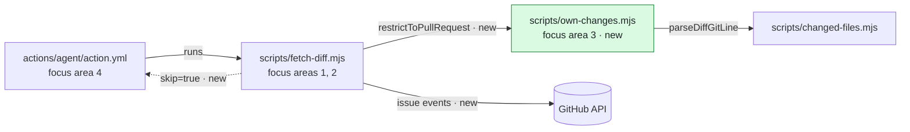

### Review guide — 2 to read closely · 2 to check · 2 to skim

**In short.** After a green review, a merge of `main` into a pull request made the next incremental
review cover code from other pull requests. This pull request cuts the incremental diff down to the
pull request's own changes. When a merge brings nothing of its own and the last review was green, no
agent runs. A change of the base branch turns off both rules.

**Intent.** The changes match the description. No change is outside the described scope. No linked
issue.



<sub>Where the changes sit. Green: new. Dashed: new step output.</sub>

#### Recommended focus areas

| # | Focus area | Category | Recommendation | Why the agent suggests it |
| --- | --- | --- | --- | --- |
| 1 | [Skip decision in `fetch-diff.mjs`](https://github.com/deyai-labs/pr-pitcrew/pull/43/files#diff-38f1acff8b03b0208de7e60012b63652c5bf074a9cedbfabdf0eb098872a4e97R386) · +67 −4 | 🔒 Security | ▰▰▰ Read closely | The only path that ends green without a review. An error could let unreviewed code pass. |
| 2 | [Base-change guard](https://github.com/deyai-labs/pr-pitcrew/pull/43/files#diff-38f1acff8b03b0208de7e60012b63652c5bf074a9cedbfabdf0eb098872a4e97R221) · +51 −2 | 🔒 Security · 🏛️ Architecture | ▰▰▰ Read closely | Closes a bypass through a base switch. A gap could reopen it. |
| 3 | [Diff cut in `own-changes.mjs`](https://github.com/deyai-labs/pr-pitcrew/pull/43/files#diff-2d976e6398eee16aabe46ddb2be3b6a8f400d6ae734cc5f74d8e767a077759caR253) · +304 −2 | 💼 Domain logic · 🏛️ Architecture | ▰▰▱ Check | Decides which changes an agent sees. An error could hide one from an incremental review. |
| 4 | [Skip guard in the composite action](https://github.com/deyai-labs/pr-pitcrew/pull/43/files#diff-b1d75cb3bd52a0789483f7a430148e25f041d949b636dee7c45164f4a1e6d0daR279) · +17 −9 | ⚙️ Operations · 🏛️ Architecture | ▰▰▱ Check | 11 steps now depend on one output. A missing condition could run a step without its inputs. |

Also changed, 🧹 routine, to skim:
[5 · Tests](https://github.com/deyai-labs/pr-pitcrew/pull/43/files#diff-726d2f77946a46ae5ddd8c42ba866b38cb83f09801224ee81187486d7cc64efbR317) +423 ·
[6 · Docs, changelog, version](https://github.com/deyai-labs/pr-pitcrew/pull/43/files#diff-8c1b3cc3454395d4e4bf3ab7f53af8869b940cb2ea83a8f8c44e20b19faea443R304) +54 −6

Reading load: **+118 −6** to read closely · +321 −11 to check · +477 −6 to skim.

#### Focus areas in suggested order

##### ▰▰▰ Read closely

<details open>
<summary><b>1 · Skip decision in <code>fetch-diff.mjs</code></b> · 🔒 Security · +67 −4</summary>

**Context.** `fetch-diff.mjs` runs before each review agent. It decides which diff the agent sees:
the whole pull request, or only the commits since the last published review.

**What changes.** `main()` gets a new outcome: `skip`. The run ends before the agent starts, and the
check stays green. This happens only when the new commits add nothing of the pull request's own and
the last published review was green.

**Why the agent suggests it.** This is the only path that ends green without a review. An error here
could let unreviewed code pass the gate. Possible consequence: **severe**. Safeguards found:
**none**, no test seems to cover the decision in `main()`.

```diff
+      if (nothingNew) {
+        if (baseMoved === false && review?.clean) {
+          skip(base, after);
+          return;
+        }
+        if (baseMoved === false) {
+          console.log(`The review of ${base.slice(0, 7)} did not pass, so its findings still stand; reviewing the whole pull request.`);
+        } else {
+          console.log('Reviewing the whole pull request.');
+        }
```

<sub>[`scripts/fetch-diff.mjs` L386–L395](https://github.com/deyai-labs/pr-pitcrew/pull/43/files#diff-38f1acff8b03b0208de7e60012b63652c5bf074a9cedbfabdf0eb098872a4e97R386), from the diff</sub>


<sub>Simplified. An empty compare diff takes the "Anything left? — no" path directly.</sub>

**To verify**

- [ ] `skip()` runs only when `baseMoved === false` and the last review was clean
  ([L386–L389](https://github.com/deyai-labs/pr-pitcrew/pull/43/files#diff-38f1acff8b03b0208de7e60012b63652c5bf074a9cedbfabdf0eb098872a4e97R386)).
- [ ] A review that failed the gate never leads to `skip`
  ([L391–L392](https://github.com/deyai-labs/pr-pitcrew/pull/43/files#diff-38f1acff8b03b0208de7e60012b63652c5bf074a9cedbfabdf0eb098872a4e97R391)).
- [ ] When `pullDiffAt` returns `null`, the run reviews the whole pull request
  ([L366–L371](https://github.com/deyai-labs/pr-pitcrew/pull/43/files#diff-38f1acff8b03b0208de7e60012b63652c5bf074a9cedbfabdf0eb098872a4e97R366)).

**Code:** [`main()` L334–L404](https://github.com/deyai-labs/pr-pitcrew/pull/43/files#diff-38f1acff8b03b0208de7e60012b63652c5bf074a9cedbfabdf0eb098872a4e97R334)
· [`skip()` L313–L324](https://github.com/deyai-labs/pr-pitcrew/pull/43/files#diff-38f1acff8b03b0208de7e60012b63652c5bf074a9cedbfabdf0eb098872a4e97R313)
· [file at `812d742`](https://github.com/deyai-labs/pr-pitcrew/blob/812d74244ea70b5fe0f8b447856dc19061ca60d3/scripts/fetch-diff.mjs#L334-L404)

</details>

<details open>
<summary><b>2 · Base-change guard</b> · 🔒 Security · 🏛️ Architecture · +51 −2</summary>

**Context.** The cut and the skip compare against the pull request diff. GitHub computes that diff
against the base branch the pull request names now, and the author can change that branch.

**What changes.** Before the cut or the skip applies, the run reads the events of the pull request.
If the base branch changed since the last review, or the events cannot be read in full, neither rule
applies.

**Why the agent suggests it.** The guard closes a bypass: switch the base, merge that branch, switch
back. A gap here could reopen it. Possible consequence: **severe**. Safeguards found: **partial**,
four tests cover `baseChangedSince`, none seems to cover the paging in `baseMovedSince`.

**Architecture.** New use of an external API: the issue events of the pull request, up to 10 pages of
100 per run.

```diff
+async function baseMovedSince(since) {
+  const events = [];
+  for (let page = 1; page <= MAX_EVENT_PAGES; page++) {
+    const body = await jsonGet(`/repos/${repository}/issues/${prNumber}/events?per_page=100&page=${page}`);
+    if (body === null || !Array.isArray(body)) return null;
+    events.push(...body);
+    if (body.length < 100) return baseChangedSince(events, since);
+  }
+  return null;
 }
```

<sub>[`scripts/fetch-diff.mjs` L257–L266](https://github.com/deyai-labs/pr-pitcrew/pull/43/files#diff-38f1acff8b03b0208de7e60012b63652c5bf074a9cedbfabdf0eb098872a4e97R257), from the diff</sub>

**To verify**

- [ ] Timestamps compare as strings
  ([L247](https://github.com/deyai-labs/pr-pitcrew/pull/43/files#diff-38f1acff8b03b0208de7e60012b63652c5bf074a9cedbfabdf0eb098872a4e97R247)).
  This is correct only if `check.started_at` and `event.created_at` use the same UTC format.
- [ ] A review with no start time counts as "base changed"
  ([L245](https://github.com/deyai-labs/pr-pitcrew/pull/43/files#diff-38f1acff8b03b0208de7e60012b63652c5bf074a9cedbfabdf0eb098872a4e97R245)).
- [ ] An event list that fills all 10 pages counts as unread
  ([L259–L265](https://github.com/deyai-labs/pr-pitcrew/pull/43/files#diff-38f1acff8b03b0208de7e60012b63652c5bf074a9cedbfabdf0eb098872a4e97R259)).
  Anyone can add events by mentioning the pull request.

**Code:** [L221–L266](https://github.com/deyai-labs/pr-pitcrew/pull/43/files#diff-38f1acff8b03b0208de7e60012b63652c5bf074a9cedbfabdf0eb098872a4e97R221)
· [call in `main()` L343–L351](https://github.com/deyai-labs/pr-pitcrew/pull/43/files#diff-38f1acff8b03b0208de7e60012b63652c5bf074a9cedbfabdf0eb098872a4e97R343)
· [file at `812d742`](https://github.com/deyai-labs/pr-pitcrew/blob/812d74244ea70b5fe0f8b447856dc19061ca60d3/scripts/fetch-diff.mjs#L221-L266)

</details>

##### ▰▰▱ Check

<details>
<summary><b>3 · Diff cut in <code>own-changes.mjs</code></b> · 💼 Domain logic · 🏛️ Architecture · +304 −2</summary>

**Context.** An incremental review looks only at the commits since the last review. When `main` was
merged in between, that range also holds changes from other pull requests.

**What changes.** A new module removes from the incremental diff all changes that the pull request
diff does not make. Added lines match by right-hand line number. A removed line stays when the pull
request diff changes the same run of lines, or removes the same text in the file.

**Why the agent suggests it.** This code decides which changes an agent sees. An error could hide a
change of the pull request from an incremental review, but not from you: the pull request still
shows the full diff. Possible consequence: **moderate**. Safeguards found: **partial**, 11 tests with
real `git diff` output cover the two matching rules, not every path of the parser.

**Architecture.** New module with pure functions and no I/O, one module and one test file as in the
rest of `scripts/`. Decision: show a line too many, never hide one. The rationale is in
`docs/how-it-works.md`. There is no ADR.

```diff
+      newNo += 1;
+    } else if (kind === '-') {
+      if (owned.removed.has(text) || changedWithin(owned, spans[index])) {
+        last = { kind: '-', text, oldNo, newNo };
+        oldNo += 1;
+      } else {
+        state.shift -= 1;
+        state.leftOut += 1;
+      }
```

<sub>[`scripts/own-changes.mjs` L199–L207](https://github.com/deyai-labs/pr-pitcrew/pull/43/files#diff-2d976e6398eee16aabe46ddb2be3b6a8f400d6ae734cc5f74d8e767a077759caR199), from the diff</sub>

**To verify**

- [ ] Both diffs end at the same commit. `pullDiffAt` checks the head SHA
  ([fetch-diff.mjs L186–L190](https://github.com/deyai-labs/pr-pitcrew/pull/43/files#diff-38f1acff8b03b0208de7e60012b63652c5bf074a9cedbfabdf0eb098872a4e97R186)).
- [ ] A removed line stays when either rule matches
  ([L201](https://github.com/deyai-labs/pr-pitcrew/pull/43/files#diff-2d976e6398eee16aabe46ddb2be3b6a8f400d6ae734cc5f74d8e767a077759caR201)).
- [ ] Files that only the base branch changed drop out
  ([L260–L263](https://github.com/deyai-labs/pr-pitcrew/pull/43/files#diff-2d976e6398eee16aabe46ddb2be3b6a8f400d6ae734cc5f74d8e767a077759caR260)).

**Code:** [`restrictToPullRequest` L253–L282](https://github.com/deyai-labs/pr-pitcrew/pull/43/files#diff-2d976e6398eee16aabe46ddb2be3b6a8f400d6ae734cc5f74d8e767a077759caR253)
· [`keepOwned` L175–L216](https://github.com/deyai-labs/pr-pitcrew/pull/43/files#diff-2d976e6398eee16aabe46ddb2be3b6a8f400d6ae734cc5f74d8e767a077759caR175)
· [file at `812d742`](https://github.com/deyai-labs/pr-pitcrew/blob/812d74244ea70b5fe0f8b447856dc19061ca60d3/scripts/own-changes.mjs#L253-L282)
· [tests L317–L398](https://github.com/deyai-labs/pr-pitcrew/pull/43/files#diff-726d2f77946a46ae5ddd8c42ba866b38cb83f09801224ee81187486d7cc64efbR317)

</details>

<details>
<summary><b>4 · Skip guard in the composite action</b> · ⚙️ Operations · 🏛️ Architecture · +17 −9</summary>

**Context.** `actions/agent/action.yml` is the composite action that runs every agent, one step after
the other: fetch the inputs, build the configuration, run the agent, publish the report.

**What changes.** The step `Fetch the diff` gets the id `diff`. Every later step gets the condition
`steps.diff.outputs.skip != 'true'`.

**Why the agent suggests it.** The change is mechanical, but 11 steps now depend on one output. A
missing condition could run a step without its inputs. Possible consequence: **moderate**.
Safeguards found: **none**, no test seems to check the conditions.

**Architecture.** New contract between a script and the action: `fetch-diff.mjs` writes the step
output `skip`, and 11 steps read it. A step added later must read it too. A green check now has a
second meaning: "nothing new to review", next to "reviewed, nothing at the gate".

```diff
     # every runner image - it is not in the Playwright one - and an agent that
     # has to fetch nothing needs fewer rights to do its job.
     - name: Fetch the linked issue
-      if: steps.manifest.outputs.wants-issue == 'true'
+      if: steps.manifest.outputs.wants-issue == 'true' && steps.diff.outputs.skip != 'true'
       shell: bash
```

<sub>[`actions/agent/action.yml` L303–L307](https://github.com/deyai-labs/pr-pitcrew/pull/43/files#diff-b1d75cb3bd52a0789483f7a430148e25f041d949b636dee7c45164f4a1e6d0daR303), from the diff</sub>

**To verify**

- [ ] All 11 steps after `Fetch the diff` carry the condition.
- [ ] Both steps that run the agent carry it. Without it, the agent would start with an empty
  `OPENCODE_CONFIG_CONTENT`
  ([L452](https://github.com/deyai-labs/pr-pitcrew/pull/43/files#diff-b1d75cb3bd52a0789483f7a430148e25f041d949b636dee7c45164f4a1e6d0daR452),
  [L507](https://github.com/deyai-labs/pr-pitcrew/pull/43/files#diff-b1d75cb3bd52a0789483f7a430148e25f041d949b636dee7c45164f4a1e6d0daR507)).
- [ ] An agent without the `diff` input (acceptance test) is not affected: `skip` is empty there.

**Code:** [`action.yml` L279–L284](https://github.com/deyai-labs/pr-pitcrew/pull/43/files#diff-b1d75cb3bd52a0789483f7a430148e25f041d949b636dee7c45164f4a1e6d0daR279)
· [last guarded step L634](https://github.com/deyai-labs/pr-pitcrew/pull/43/files#diff-b1d75cb3bd52a0789483f7a430148e25f041d949b636dee7c45164f4a1e6d0daR634)
· [file at `812d742`](https://github.com/deyai-labs/pr-pitcrew/blob/812d74244ea70b5fe0f8b447856dc19061ca60d3/actions/agent/action.yml#L279-L634)

</details>

##### ▰▱▱ Skim

<details>
<summary><b>5 · Tests</b> · 🧹 Routine · +423 −0</summary>

**Context.** The tests for focus areas 2 and 3. Their names state the rules.

[`own-changes.test.mjs` L317–L398](https://github.com/deyai-labs/pr-pitcrew/pull/43/files#diff-726d2f77946a46ae5ddd8c42ba866b38cb83f09801224ee81187486d7cc64efbR317)
· [`fetch-diff.test.mjs` L202–L224](https://github.com/deyai-labs/pr-pitcrew/pull/43/files#diff-2d2bf979498576f4bdbf0392aea1d166d34ed55e711c1b8cb6779378bc259e18R202)

</details>

<details>
<summary><b>6 · Docs, changelog, version</b> · 🧹 Routine · +54 −6</summary>

**Context.** `docs/how-it-works.md` describes the cut, the skip and the guard. `CHANGELOG.md` and
`package.json` move to 1.3.1.

[`how-it-works.md` L304–L335](https://github.com/deyai-labs/pr-pitcrew/pull/43/files#diff-8c1b3cc3454395d4e4bf3ab7f53af8869b940cb2ea83a8f8c44e20b19faea443R304)
· [`CHANGELOG.md`](https://github.com/deyai-labs/pr-pitcrew/pull/43/files#diff-06572a96a58dc510037d5efa622f9bec8519bc1beab13c9f251e97e657a9d4ed)
· [`package.json`](https://github.com/deyai-labs/pr-pitcrew/pull/43/files#diff-7ae45ad102eab3b6d7e7896acd08c427a9b25b346470d7bc6507b6481575d519)

</details>

**Coverage.** 8 of 8 files and 939 of 939 changed lines are in a group. Not assessed: nothing.

<details>
<summary>What the categories and reading modes mean</summary>

| Category | Covers |
| --- | --- |
| 💼 Domain logic | Business rules with business risk: calculations, prices, contracts, states of business objects |
| 👥 UX | Behaviour users see: flows, forms, error messages, accessibility |
| 🔒 Security | Login, permissions, input handling, secrets, trust boundaries, new dependencies |
| 🪪 Privacy | Personal data: collected, stored, shared, logged or deleted |
| 🗄️ Data | Stored data: schema, migrations, deletions, consistency |
| 🏛️ Architecture | Structure: module boundaries, new components and dependencies, contracts, public APIs, decisions |
| ⚙️ Operations | Deployment, CI/CD, configuration, performance, monitoring, cost |
| 🧹 Routine | Tests, docs, formatting, refactoring without new behaviour, generated code |

| Reading mode | When |
| --- | --- |
| ▰▰▰ Read closely | A severe consequence is possible, and little protects against it. |
| ▰▰▱ Check | A moderate consequence is possible, or a severe one with strong protection. |
| ▰▱▱ Skim | A minor consequence at most, or a moderate one with strong protection. |

The agent answers fixed questions for each group. The reading mode follows from a fixed table, not
from a choice of the agent. Path rules can raise it. See
[how the guide rates changes](review-guide.md#65-einstufung-und-normalisierung).

</details>

<sub>Recommendations by an AI agent, not a verified or complete review. Every line stays in the diff.
· Code excerpts are copied from the diff, not written by the agent. · Describes `812d742` · 8 of 8
changed files opened · All ratings and corrections are in the
[run summary](https://github.com/deyai-labs/pr-pitcrew/actions).</sub>
<!-- pitcrew:summary:review-guide -->
